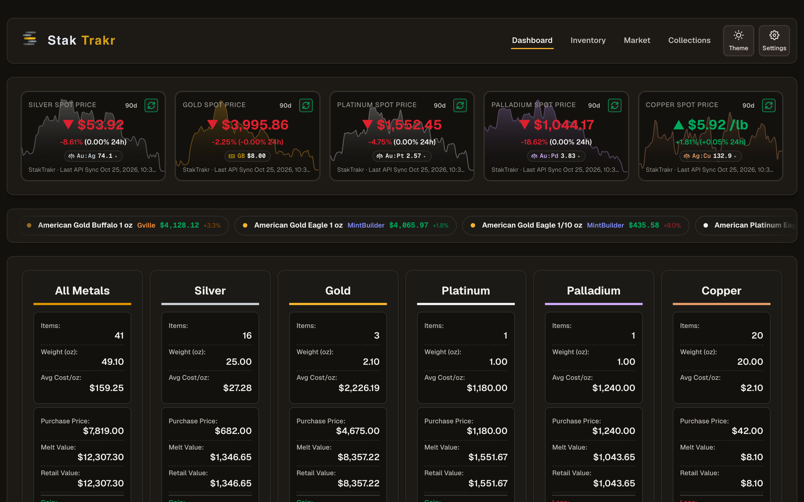
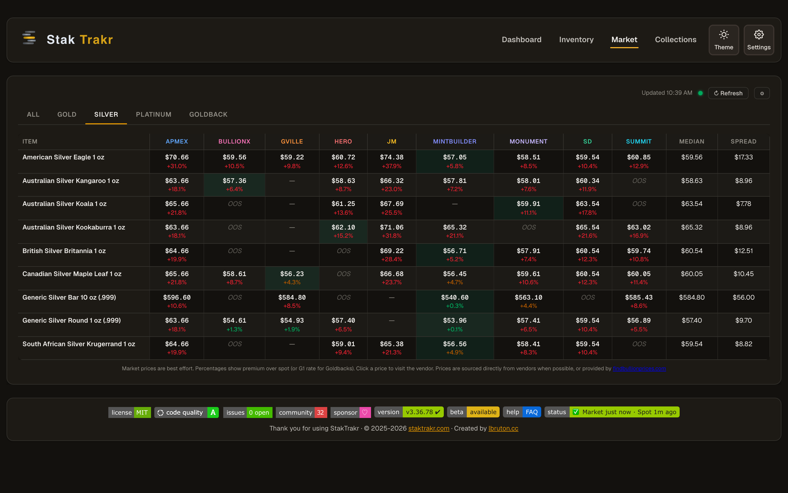
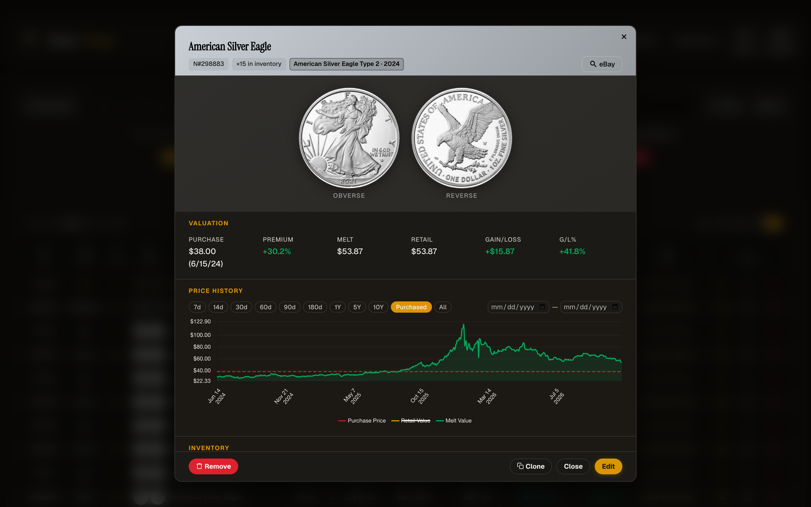
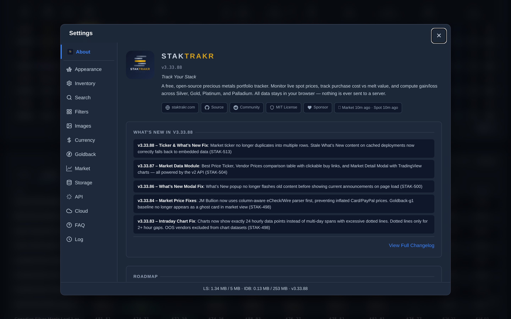
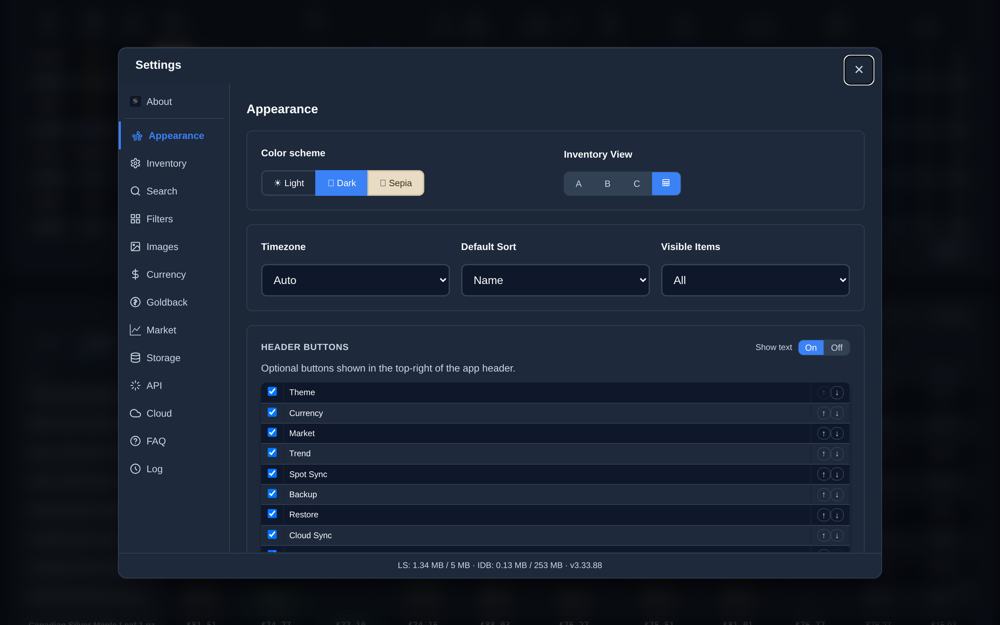
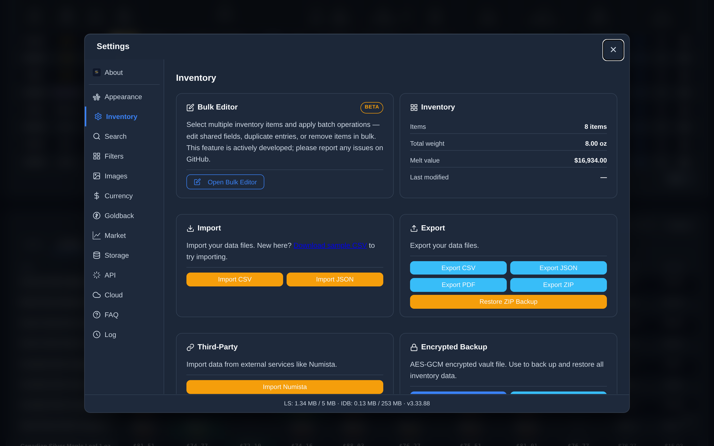

<h1 align="center">
  
</h1>

  Track your precious metals stack. Your way.

  
  
  
  
  

  <a href="https://www.staktrakr.com">Launch App</a> &bull;
  <a href="https://beta.staktrakr.com">Beta</a> &bull;
  <a href="https://lbruton.github.io/StakTrakr/about.html">About</a> &bull;
  <a href="CHANGELOG.md">Changelog</a>

---

A privacy-first portfolio tracker for Silver, Gold, Platinum, Palladium and Goldbacks. It runs entirely in your browser, and your data stays on your device.

| Vendor Price Matrix                                | Item View Modal                                  |
| -------------------------------------------------- | ------------------------------------------------ |
|  |  |

| Settings: About                                      | Appearance                                                     | Inventory                                                    |
| ---------------------------------------------------- | -------------------------------------------------------------- | ------------------------------------------------------------ |
|  |  |  |

Release notes are in the [Changelog](CHANGELOG.md) and in the What's New panel in Settings.

---

## Why StakTrakr?

Many precious metals apps ask for your email, store your data on their servers or lock features behind a paywall. StakTrakr does none of these:

- Client-side only. All data lives in your browser. The source is open, and the app runs from a single HTML file on `file://`.
- No data collection. There is no account, email or profile. Data leaves your device only when you turn on cloud backup.
- Works offline. Once loaded, the app runs without a connection. Live spot prices need one.
- Portable and free. Download the ZIP, open `index.html` and run it anywhere. MIT licensed.

Optional [sponsorships](https://github.com/sponsors/lbruton) pay for the free API infrastructure.

---

## Features

### Pricing: Spot and Market

Spot prices come from several providers with automatic failover. The free, keyless `api.staktrakr.com` works out of the box. Add Metals.dev, MetalPriceAPI, GoldAPI or a custom URL for more frequent updates. Manual mode prices items fully offline. Sparkline charts offer 7d, 30d, 60d and 90d ranges, with health indicators and seed history back to 1968.

For retail, the Best Price Ticker shows the cheapest vendor for each coin, with a direct buy link. The Vendor Prices Matrix compares Gold, Silver, Platinum, Palladium and Goldbacks across major bullion dealers. It shows premium badges and links to each product page. Click a coin to open a TradingView chart of spot history with a price line per vendor.

### Portfolio Tracking

Each item records Purchase Price, Melt and Retail, with Gain/Loss per item and across the portfolio. Sold, Traded, Lost, Gifted and Returned dispositions record realized gains and losses with full transaction history. Items switch between lot and each purchase. Weights in troy ounces, kilograms and pounds convert automatically.

Graded coins store year, grade, grading authority and cert number. Bars and notes store serial numbers. Every item can hold notes, photos (your own or from the Numista CDN), price history and a storage location. Goldbacks and Silverbacks use denomination-aware pricing.

### Browse: Cards, Table, Filters, Tags

Four card styles are available: sparkline header, full-bleed image, split layout and accessible table. A sortable table view adds thumbnails and inline chip badges. Filter chips build themselves from your collection across 10 categories, such as Metal, Type, Year, Grade and Storage. You can group chips, save a search as a chip and hide chips with a right-click. Tags come from Numista (Bullion, Proof, Commemorative) or from you, and work with filters, rename and delete.

### Catalog: Numista and PCGS

Numista search works by name, country or catalog number. Bulk sync pulls metadata and CDN images with a progress log. Regex rules match catalog IDs to your item names. PCGS lookup by number fills the form, and cert badges link to PCGS and NGC.

Each field records its origin: Numista, PCGS, CSV import or manual entry. A two-tier re-sync picker uses that origin to choose sensible defaults. The Item View Modal charts melt and retail price history over 1Y, 5Y, 10Y, Purchased or a custom range. It also shows Numista metadata, tags, the cert badge and disposition history.

### Cloud Sync: Encrypted, Zero-Knowledge

Connect Dropbox through OAuth PKCE to sync an encrypted `.stvault` file across devices. Encryption uses AES-256-GCM with PBKDF2-SHA256 (600,000 iterations) through the Web Crypto API. The cloud provider receives only ciphertext.

Sync runs both ways and detects conflicts. The DiffModal shows item and settings changes, and you pick each field with a click. An encrypted image vault syncs photos. Leader election across tabs prevents concurrent sync runs. Sync also supports several accounts and keeps a configurable number of backups before each overwrite. Support for Google Drive, OneDrive, pCloud and Box is planned, with the same client-side encryption.

### Data Tools: Import, Export, Backup, Bulk Edit

CSV import maps fields automatically, accepts regex rules and offers merge or override modes with a DiffModal preview. Export writes CSV, JSON, PDF or a full ZIP backup. Encrypted `.stvault` exports show a password strength meter. Spot history moves between instances by import and export.

Clone an item inline with Save & Clone Another. Bulk Edit in Settings → Inventory edits 16 fields across many items at once. It also copies and deletes in bulk, and fills fields from a Numista lookup.

### Settings

Settings groups every option behind a sidebar:

| Tab            | Contents                                                                                                |
| -------------- | ------------------------------------------------------------------------------------------------------- |
| **About**      | Version info, API status badge, What's New, badges, changelog, force refresh                            |
| **Appearance** | Theme (Light / Dark / Slate / Sepia), header button visibility and order, layout section toggles        |
| **Inventory**  | Card styles (A/B/C/D), default sort, visible rows, import/export/backup controls, bulk edit, data reset |
| **Filters**    | Category toggles, sort order, grouping rules, blacklist, max chip count, search behavior                |
| **Images**     | Image cache management, upload settings, bulk image sync                                                |
| **Currency**   | Display currency (17 currencies), exchange rates, Goldback pricing controls                             |
| **Market**     | Market data toggles, vendor display preferences                                                         |
| **Storage**    | localStorage and IndexedDB usage dashboard                                                              |
| **API**        | Spot price source selection, Numista and PCGS catalog integration, usage tracking                       |
| **Cloud**      | Dropbox connection, cloud backup/restore, sync history, multi-account management                        |
| **Log**        | Activity Log with full change history and undo/redo                                                     |
| **FAQ**        | Privacy, backup, security and limitations                                                               |

The app also installs as a PWA and converts between 17 currencies at live exchange rates. Search matches fuzzily across all fields. Shift+click or long-press edits a value inline. Dates follow your timezone, and the disposed filter has three states. Non-production domains show a BETA, PREVIEW or LOCAL badge.

---

## Getting Started

Open [www.staktrakr.com](https://www.staktrakr.com) for the hosted version. To run it locally, download a release ZIP, extract it and open `index.html` in a modern browser. No server is required. For development, run `python3 -m http.server 8000`.

StakTrakr ships with labeled sample inventory and years of spot history, so every feature works on first launch.

Two optional integrations add catalog data. A free [Numista API](https://en.numista.com/api/) key enables catalog search, images and metadata sync. A free [PCGS API](https://www.pcgs.com/coinfacts) key enables PCGS lookup and cert verification. Configure both in Settings → API.

---

## Data & Privacy

- No server-side component. The developer has no technical means to access your data.
- No cookies, tracking SDKs or advertising. Your data lives only in localStorage and IndexedDB.
- Zero-knowledge cloud backup. AES-256-GCM with PBKDF2-SHA256 (600,000 iterations); the cloud provider receives only ciphertext.
- Browser storage can be cleared. Export a ZIP or vault backup regularly, especially on iOS Safari.
- The hosted site runs Cloudflare Web Analytics: aggregated, anonymous page views only. A local copy has no analytics.

The [Privacy Policy](https://www.staktrakr.com/privacy.html) and the FAQ tab in Settings hold the details.

---

## Tech Stack

| Layer            | Technology                                                                     |
| ---------------- | ------------------------------------------------------------------------------ |
| Runtime          | Client-side JavaScript (no framework, no build step)                           |
| Storage          | Browser localStorage + IndexedDB                                               |
| Encryption       | Web Crypto API: AES-256-GCM via PBKDF2                                         |
| Styling          | Vanilla CSS with CSS custom properties (oklch token system), four themes       |
| Charts           | Chart.js 3.9.1 + TradingView Lightweight Charts                                |
| CSV / PDF / ZIP  | PapaParse 5.4.1, jsPDF 2.5.1 + AutoTable 3.5.25, JSZip 3.10.1                  |
| Hosting          | Cloudflare Pages                                                               |
| Spot API         | api.staktrakr.com (free, keyless) + Metals.dev, MetalPriceAPI, GoldAPI, others |
| Market API       | api.staktrakr.com v2 (free, keyless): retail prices from major bullion dealers |
| Catalog          | Numista API, PCGS CoinFacts                                                    |
| Exchange Rates   | Open Exchange Rates                                                            |
| Security tooling | Codacy (A+), CodeQL, Semgrep, PMD, ESLint                                      |

---

## Contributing

Bug reports and pull requests are welcome. Open an [issue](https://github.com/lbruton/StakTrakr/issues) before you start a large change. The app stays a zero-install, single-page, vanilla JS application: no build step, no framework, and it runs on `file://`. Development tooling lives in `devops/`.

## License

MIT License. See [LICENSE](LICENSE).

## Community

- Reddit: [r/staktrakr](https://www.reddit.com/r/staktrakr/)
- Issues: [GitHub Issues](https://github.com/lbruton/StakTrakr/issues)
- Sponsor: [GitHub Sponsors](https://github.com/sponsors/lbruton)
