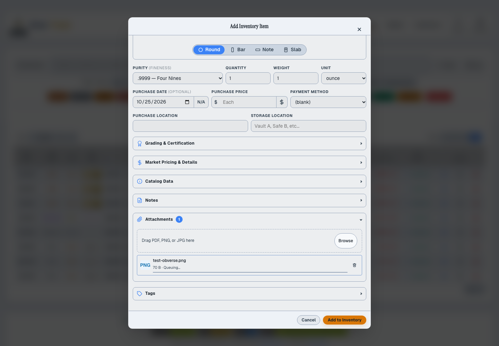
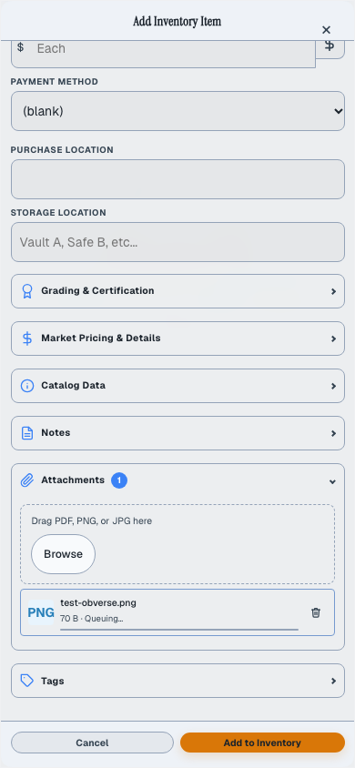
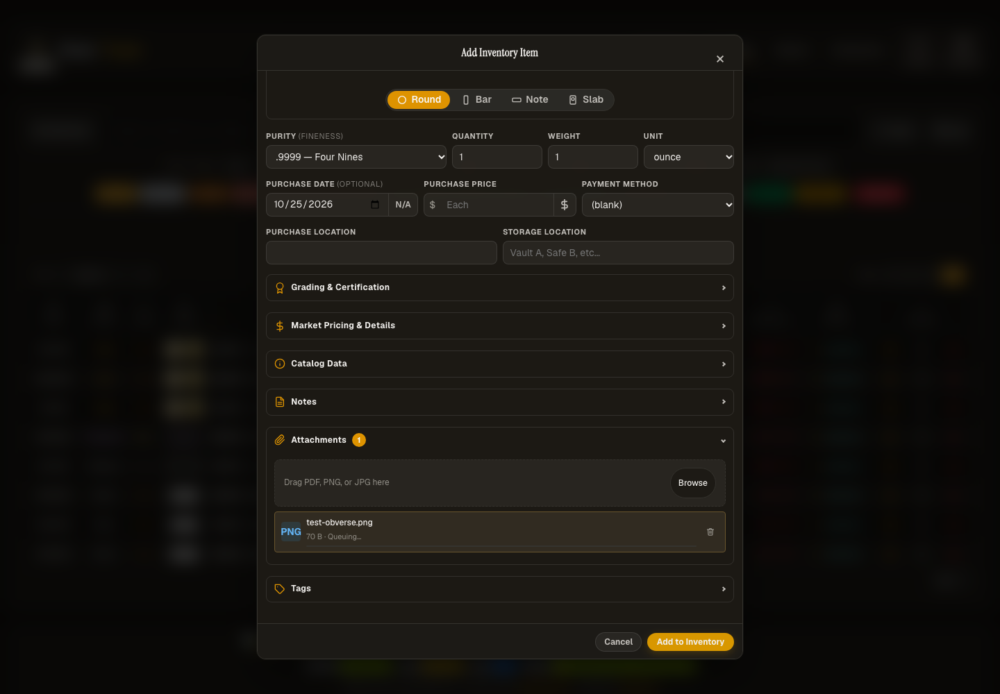
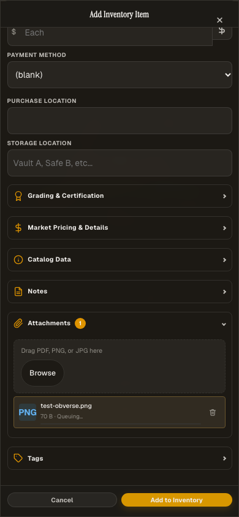
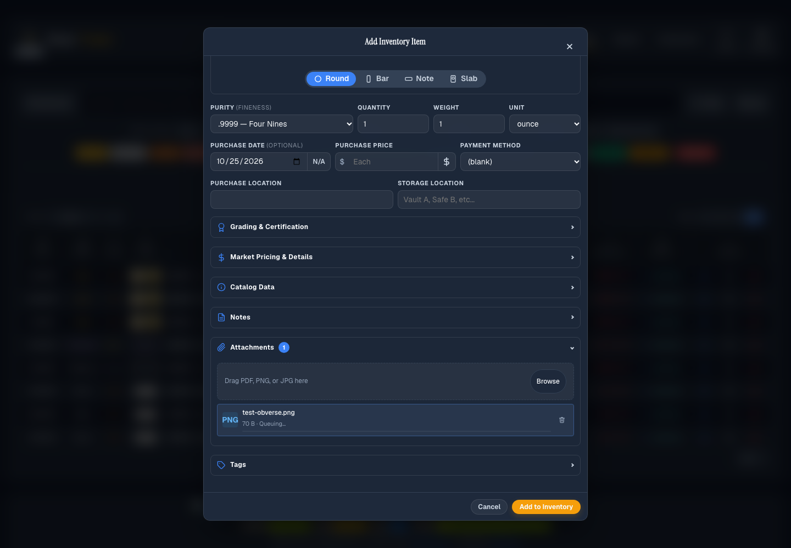
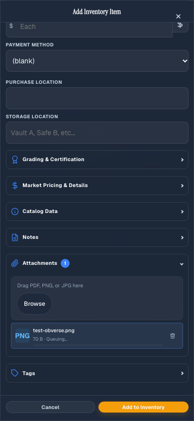
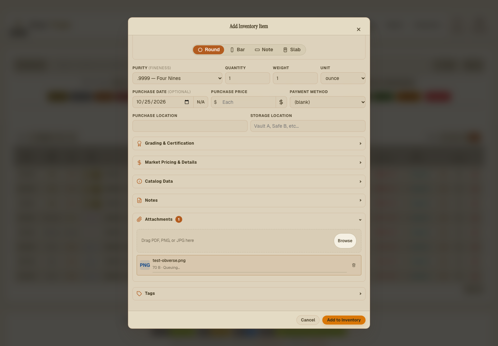
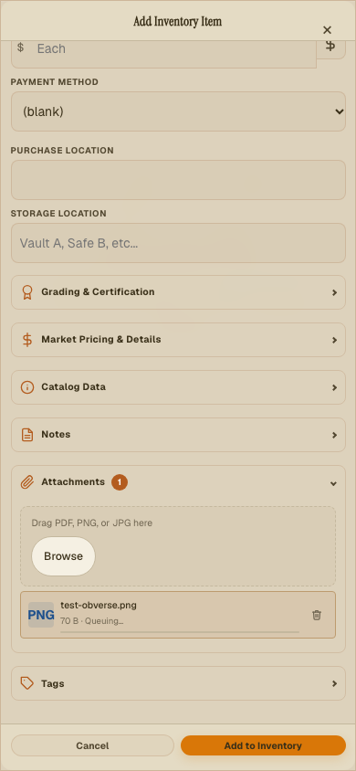

# Shared control transition evidence

Captured from Chromium against the patch stylesheet on 2026-10-25 (America/Chicago).
The Item form contains a queued image attachment. Desktop is 1440 × 1000; phone is 390 × 844.

| Theme | Desktop                                                    | Phone                                                  |
| ----- | ---------------------------------------------------------- | ------------------------------------------------------ |
| Light |  |  |
| Dark  |    |    |
| Slate |  |  |
| Sepia |  |  |

Equivalent `*-reduce.png` captures record the reduced-motion state at both sizes in each theme.

[Normal motion recording](controls-normal-motion.webm) · [Reduced motion recording](controls-reduced-motion.webm)

The recordings exercise focus and blur, disclosure close and reopen, and two hover/exit cycles on the
submit button, attachment drop zone, Browse button and queued attachment action. Assertions verify
200ms normal timing, zero reduced-motion duration/delay and settled visual states. Existing input
transition overrides and the immediate theme-colour regression remain covered.
